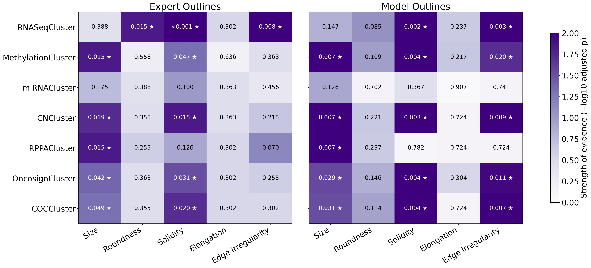
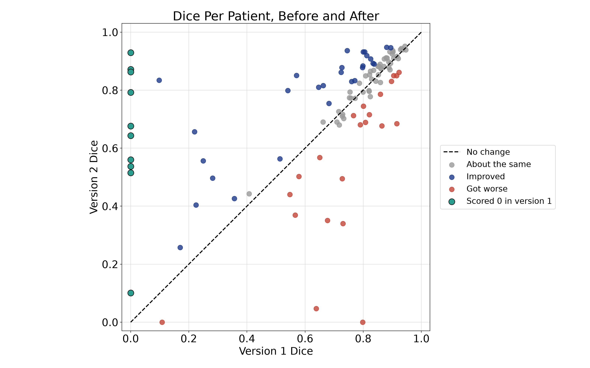
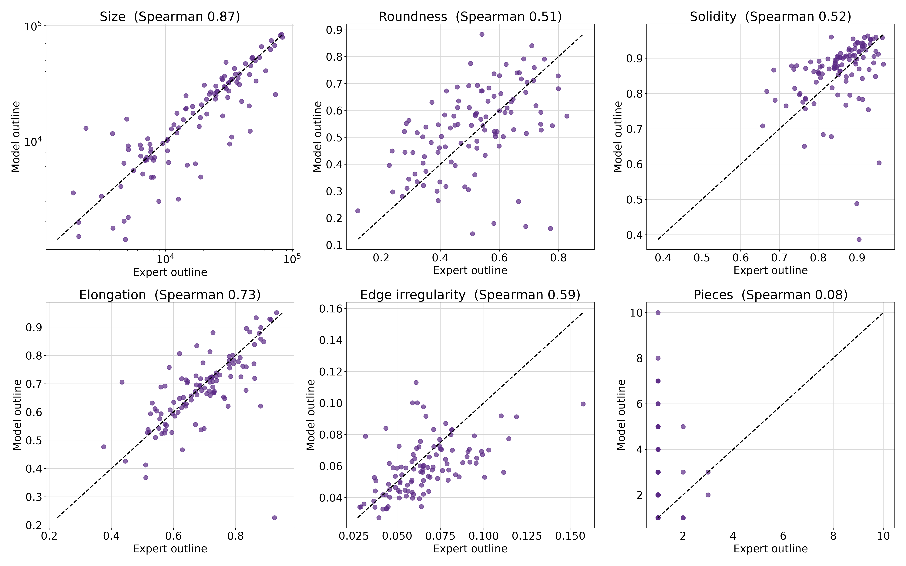
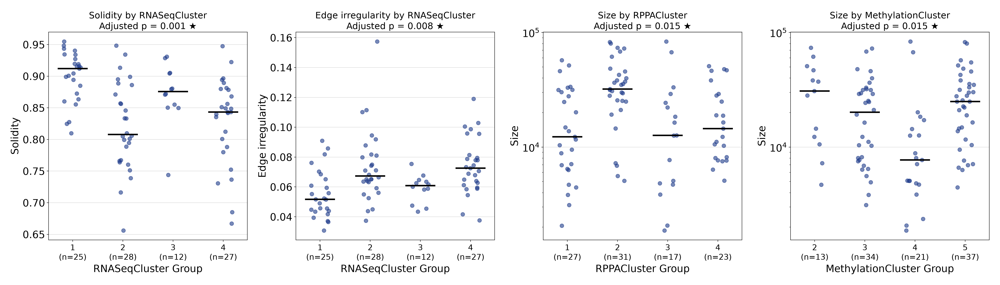

# Tumor Shape and Genetics in Gliomas

**Can the shape of a brain tumor on an MRI scan tell us something about its genetics?**

This project trains a deep learning model to outline lower-grade gliomas on MRI, measures the shape of each tumor, and tests whether those shapes differ between genetic subtypes. It follows the approach of Buda, Saha, and Mazurowski (2019) and reproduces their two main findings independently.

**Author:** Kaylie Hynes · [Portfolio](https://kayliehynes1.github.io) · [LinkedIn](https://www.linkedin.com/in/kaylie-hynes-/)

---

## Key results

- **Tumor shape tracks genetics.** 12 of 35 shape and genetics tests were significant after correcting for multiple testing. The strongest was **solidity by RNASeqCluster** (adjusted p < 0.001, large effect), with group 1 tumors forming the most compact masses and group 2 tumors showing the most dents and inlets.
- **The findings reproduce published work.** Buda et al. (2019) reported compactness and edge bumpiness as the two shape features linked to RNASeqCluster. This project found the same two links using its own model, its own shape code, and a different statistical test.
- **The automatic pipeline can stand in for an expert.** Running the same tests on the model's outlines instead of the expert's confirmed 11 of the 12 findings.
- **Debugging rescued the failures.** The first version missed the tumor completely in 10 patients. Checking those failures pointed to dark scans and missing scan types. Fixing both brought 9 of the 10 back (most to a Dice above 0.5), raising the mean Dice from 0.68 to 0.75.



---

## Background

Gliomas are brain tumors that start in glial cells, the support cells of the brain. Lower-grade gliomas grow more slowly than glioblastoma but often become more aggressive over time.

The Cancer Genome Atlas (TCGA) measured several layers of activity in each tumor, such as which genes are switched on (RNA sequencing), chemical tags that switch genes off (methylation), and missing or extra chunks of DNA (copy number). For each layer, patients were sorted into groups, or clusters, whose tumors look alike.

**Radiogenomics** asks whether what we can see on a scan reflects what's happening in a tumor's genes. If it does, an MRI could one day give genetic clues without surgery to take a tissue sample. Tumors with different genetics may grow in different ways, some pushing outward as smooth, round masses and others creeping into the brain with irregular edges. This project tests whether those shapes line up with the genetic clusters.

---

## Data

The [LGG MRI Segmentation dataset](https://www.kaggle.com/datasets/mateuszbuda/lgg-mri-segmentation) on Kaggle, released by Buda et al. (2019).

- **110 patients** from the TCGA lower-grade glioma collection, with scans from The Cancer Imaging Archive
- **3,929 MRI slices**, each with three channels (pre-contrast, FLAIR, and post-contrast)
- **Expert tumor outlines** of the FLAIR abnormality on every slice
- **Genetic clusters** for each patient (RNASeq, methylation, miRNA, copy number, RPPA, Oncosign, and the combined COC cluster)

The dataset is not included in this repository. Download it from Kaggle to run the notebooks.

---

## Pipeline

| Step | Notebook | What it does | Runs on |
|---|---|---|---|
| 1 | `data_exploration.ipynb` | Loads the scans, outlines, and genetic clusters, and checks how many patients fall into each group | Mac |
| 2 | `training_unet_kaggle.ipynb` | Version 1. Trains a 2D U-Net with 5-fold cross-validation, so every patient gets an outline from a model that never saw them | Kaggle GPU |
| 2b | `training_figures.ipynb` | Redraws the training figures from saved results | Mac |
| 2c | `checking_failures.ipynb` | Investigates why some patients scored a Dice of 0 | Mac |
| 2d | `retraining_unet.ipynb` | Version 2. Retrains with the brightness and missing-scan fixes | Kaggle GPU |
| 2e | `comparing_training_v.ipynb` | Compares every patient's Dice score from version 1 and version 2 | Mac |
| 3 | `measuring_shapes.ipynb` | Measures five shape features from both the expert's and the model's outlines | Mac |
| 4 | `shape_vs_genetics.ipynb` | Tests whether each shape differs between genetic groups | Mac |

The `csv` folder holds the result tables each step produces, and the `figures` folder holds the saved figures.

---

## Methods

### Segmentation

A 2D U-Net (about 1.9 million parameters) takes all three MRI channels as input and outputs a tumor outline for each slice. Patients were split into five groups, and five models were trained, each tested on the one group it never saw. Splitting by patient rather than by slice keeps any part of a test patient's brain out of training.

Training used a combined binary cross-entropy and Dice loss, the Adam optimizer, random left-right flips, and 40 epochs per fold on a Kaggle GPU. Accuracy is reported as the Dice score per patient, calculated across all of that patient's slices.

### Finding and fixing failures

The first training run missed the tumor completely in 10 patients. Comparing them with everyone else showed two causes.

1. **Dark scans.** The failed patients' scans were much darker overall (median brain brightness 14, compared with 24 for the rest). The model never learned what a tumor looks like at that brightness.
2. **Missing scan types.** 4 of the 10 were missing a pre- or post-contrast scan, which the dataset fills with a copy of the FLAIR, compared with 6% of other patients.

Version 2 added two fixes. Each patient's scans are rescaled so their brightness falls in the same range, and during training, some images have a scan randomly swapped for a copy of the FLAIR so the model learns to handle missing scans.

| | Version 1 | Version 2 | Buda et al. (2019) |
|---|---|---|---|
| Mean Dice | 0.682 | **0.749** | 0.82 |
| Median Dice | 0.799 | **0.830** | 0.85 |
| Patients scoring 0 | 10 | **2** | Not reported |



Almost all of the gain came from the 10 rescued patients. For the other 100, the average change was close to zero (+0.01), with 38 patients improving by more than 0.05, 22 getting worse by more than 0.05, and 50 staying about the same. In other words, the fixes solved the problem they were aimed at without making the model better across the board, and some of the shifts in both directions are ordinary variation between training runs. Several of the larger drops came from one hospital (CS), which could be worth checking in a future version.

### Shape measures

Five measures were taken from each patient's tumor, once from the expert's outline and once from the model's. Size uses every slice, and the other four are averaged over each patient's three slices with the most tumor.

| Measure | What it means |
|---|---|
| **Size** | Total tumor area across all slices |
| **Roundness** | How close the outline is to a circle (1 is a perfect circle) |
| **Solidity** | How filled-in the shape is compared with a rubber band stretched around it (1 has no dents) |
| **Elongation** | How stretched out the shape is (1 is as wide as it is long) |
| **Edge irregularity** | How bumpy the edge is after ignoring the overall shape (0 is smooth) |

Each measure was checked on simple test shapes (a circle, an oval, a wavy star, and a crescent) before being used on real tumors.

### Statistics

For each of the 35 combinations of shape measure and genetic cluster, a **Kruskal-Wallis test** checked whether the shape differed between that cluster's groups. Groups with fewer than 5 patients were left out. P-values were adjusted for multiple testing with the **Benjamini-Hochberg** method, and results with an adjusted p-value below 0.05 were counted as significant. Effect sizes are reported as eta-squared (η²H), roughly the share of the spread in a shape measure explained by the genetic groups.

---

## Results

### Expert and model outlines agree on shape

When the model's outline is good (Dice of 0.8 or higher), its shape measures agree closely with the expert's.

| Measure | Agreement, all 110 patients | Agreement, 60 patients with Dice ≥ 0.8 |
|---|---|---|
| Size | 0.87 | 0.98 |
| Elongation | 0.73 | 0.94 |
| Solidity | 0.52 | 0.82 |
| Edge irregularity | 0.59 | 0.81 |
| Roundness | 0.51 | 0.71 |

*Agreement is the Spearman correlation between expert and model values.*

The model consistently draws smoother outlines than the expert, with higher solidity in 71% of patients and lower edge irregularity in 67%. That's a common habit of U-Nets, and it matters here because fine edge detail is part of what's being linked to genetics.



### Shape and genetics

The strongest results using the expert's outlines:

| Measure | Cluster | Adjusted p | Effect size | Also significant with model outlines |
|---|---|---|---|---|
| Solidity | RNASeqCluster | < 0.001 | 0.24 (large) | Yes |
| Edge irregularity | RNASeqCluster | 0.008 | 0.17 (large) | Yes |
| Size | RPPACluster | 0.015 | 0.13 | Yes |
| Size | MethylationCluster | 0.015 | 0.12 | Yes |
| Roundness | RNASeqCluster | 0.015 | 0.13 | No (0.085) |
| Solidity | CNCluster | 0.015 | 0.10 | Yes |

In RNASeqCluster, group 1 tumors were the most solid (median 0.91) with the smoothest edges (0.052). Group 2 tumors were the least solid (0.81), and group 4 had the bumpiest edges (0.073).



### Comparison with Buda et al. (2019)

| Finding | Buda et al. | This project |
|---|---|---|
| Compactness vs RNASeqCluster | Bounding ellipsoid volume ratio, p < 0.0002 (their strongest) | Solidity, adjusted p < 0.001 (strongest here) |
| Edge bumpiness vs RNASeqCluster | Margin fluctuation, p < 0.005 | Edge irregularity, adjusted p = 0.008 |
| Unevenness vs RNASeqCluster | Angular standard deviation, p < 0.02 (below their cutoff) | Roundness, adjusted p = 0.015 |
| Most irregular group | RNASeq group 2 | RNASeq group 2 has the lowest solidity |

The two studies used different tests. Buda et al. tested 10 pairs chosen in advance with Fisher's exact test on quartiles and a Bonferroni cutoff of 0.005. This project tested all 35 pairs with Kruskal-Wallis and a Benjamini-Hochberg correction. The size findings (RPPACluster and MethylationCluster) were not tested by Buda et al. and should be treated as leads rather than confirmed results.

---

## Limitations

- **The clusters overlap.** Several cluster columns track the same underlying biology, and COCCluster combines the others, so the 12 significant results are a few consistent patterns showing up in more than one way, not 12 independent discoveries.
- **Association, not cause.** Shape and genetics move together in this data, but that doesn't show one causes the other.
- **One dataset.** All 110 patients come from a single collection, so the findings would need confirming in a separate group of patients.
- **2D shape measures.** Shapes are measured slice by slice, since the slice spacing differs between patients. Buda et al. used one 3D measure.
- **One mislabeled scan.** Patient TCGA_FG_A60K's FLAIR channel appears to be a different type of MRI scan, which likely explains its poor segmentation (Dice 0.10).
- **Run-to-run variation.** Each training run starts from random settings, so individual patients can shift between runs. 22 patients scored noticeably lower in version 2, and one (TCGA_FG_8189) dropped from 0.80 to 0. Averaging several training runs would give steadier outlines.

---

## How to run it

1. Download the [dataset from Kaggle](https://www.kaggle.com/datasets/mateuszbuda/lgg-mri-segmentation) and unzip it. It unzips into a folder called `archive`.
2. Install the packages.
   ```bash
   python3 -m pip install -r requirements.txt
   ```
3. Run `data_exploration.ipynb` on your computer, with the `archive` folder next to the notebook.
4. Run the training on Kaggle. Create a new notebook, import `retraining_unet.ipynb` (version 2, the final model), add the **lgg-mri-segmentation** dataset as an input, and turn on a GPU. Use **Save Version → Save & Run All** to run it in the background (about 3 hours). Download `project3_outputs_v2.zip` from the Output tab and unzip it into the project folder. To reproduce the version 1 comparison as well, do the same with `training_unet_kaggle.ipynb`, which produces `project3_outputs.zip`.
5. Run the remaining notebooks in the order shown in the Pipeline table. Each one reads and writes its files in the main project folder.

### Folder layout

```
glioma-shape-genomics/
├── data_exploration.ipynb
├── training_unet_kaggle.ipynb
├── training_figures.ipynb
├── checking_failures.ipynb
├── retraining_unet.ipynb
├── comparing_training_v.ipynb
├── measuring_shapes.ipynb
├── shape_vs_genetics.ipynb
├── requirements.txt
├── csv/                      result tables from each step
├── figures/                  saved figures
├── archive/                  dataset from Kaggle (not in this repo)
├── project3_outputs/         version 1 training results (not in this repo)
└── project3_outputs_v2/      version 2 training results (not in this repo)
```

---

## References

1. Buda M, Saha A, Mazurowski MA. Association of genomic subtypes of lower-grade gliomas with shape features automatically extracted by a deep learning algorithm. *Computers in Biology and Medicine*. 2019.
2. Mazurowski MA, Clark K, Czarnek NM, Shamsesfandabadi P, Peters KB, Saha A. Radiogenomics of lower-grade glioma: algorithmically-assessed tumor shape is associated with tumor genomic subtypes and patient outcomes in a multi-institutional study with The Cancer Genome Atlas data. *Journal of Neuro-Oncology*. 2017.
3. The Cancer Genome Atlas Research Network. Comprehensive, integrative genomic analysis of diffuse lower-grade gliomas. *New England Journal of Medicine*. 2015.
4. Ronneberger O, Fischer P, Brox T. U-Net: Convolutional networks for biomedical image segmentation. *MICCAI*. 2015.
